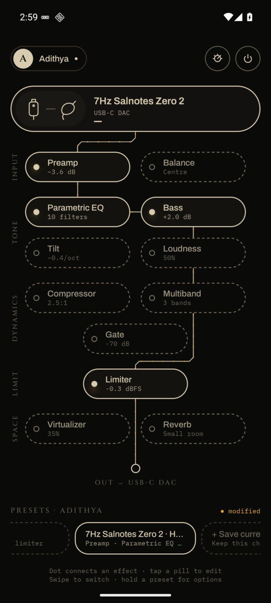
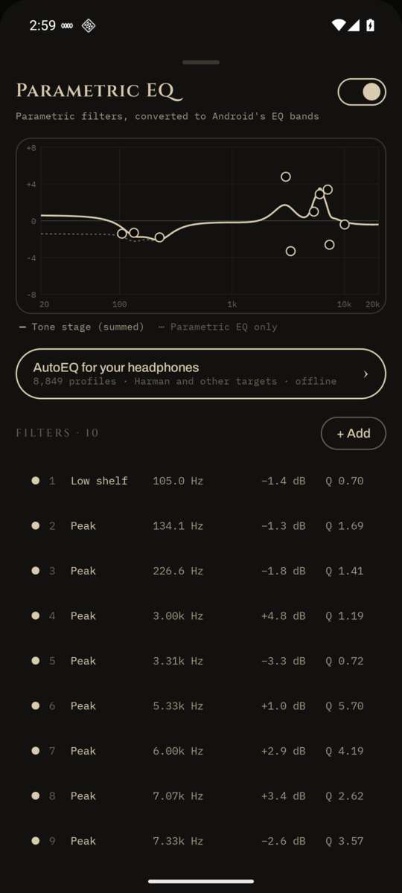
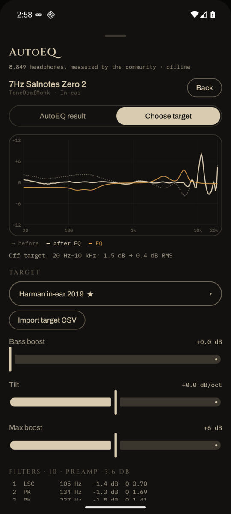
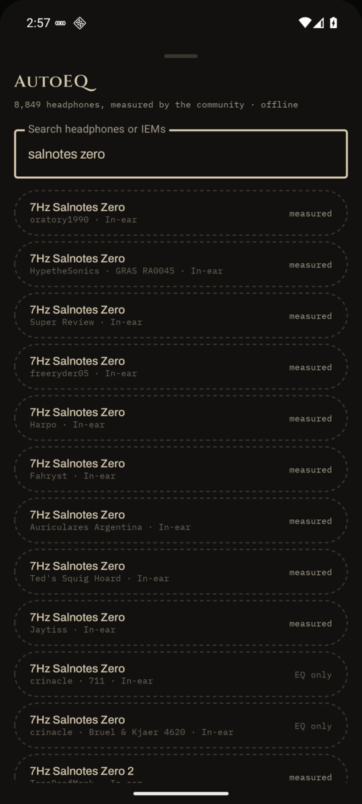

<p align="center">
  
</p>

<h3 align="center">Easy Effects for your phone.</h3>

<p align="center">
  A system-wide parametric EQ for Android that tunes <b>only your DAC and earphones</b>.<br>
  No root. No audio capture. No internet permission. No ads.
</p>

<p align="center">
  
  
  
  
</p>

<p align="center">
  
  
  
  
</p>

---

## Why Antinode

On Linux you plug in your IEMs, Easy Effects loads your preset, and everything just sounds right. On a phone you usually get one of these:

- an EQ app that **records your screen audio** to process it — adding lag, a permission prompt, and refusing to work with Spotify or Chrome
- a store EQ with **ads, weekly subscriptions** and a 10-band slider that forgets your settings the moment you switch headphones
- or **root**

Antinode is the fourth option. It plugs straight into Android's own audio effects engine, so it adds **no latency**, needs **no recording permission**, and quietly runs in the background — applying the right tuning the moment your DAC or earphones connect, and leaving the phone speaker alone.

## Features

### 🎛️ A signal chain you can see
The home screen is a circuit. Your output sits on top, every effect is a pill, and connected effects are wired together in the exact order Android processes them. Tap a pill's dot to patch it in — the dotted outline turns solid and a trace draws into the chain. Switched-off effects stay dotted and the wire runs straight behind them. When audio is flowing, a faint amber pulse travels down the wires.

### 🎧 Per-device, automatically
- Detects **USB-C DACs, wired earphones, Bluetooth, HDMI and the speaker**
- Each output keeps its own chain; plugging in loads it instantly
- **Several IEMs on one DAC?** The phone only sees the DAC — add each pair as a setup and swipe the device pill to switch
- The phone speaker is bypassed by default, so your EQ never touches calls or notifications

### 📈 AutoEQ, built in and offline
- **8,849 headphone and IEM profiles** from oratory1990, crinacle, Rtings, Super Review, ToneDeafMonk, HypetheSonics and more
- **52 target curves** — Harman in-ear 2016/2017/2019 and over-ear 2013/2015/2018 (with and without bass), diffuse field, B&K 5128, oratory1990, JM-1, LMG…
- An **on-device EQ generator** (a port of AutoEQ's method) fits a fresh 10-filter parametric EQ to any target, with bass boost, tilt and boost limits — live before/after graph and error readout
- Picks the **target variant made for each measurement rig** automatically, so Rtings measurements get Rtings-compensated targets
- **Import your own target** as a CSV from squig.link, REW or AutoEQ

### 🔊 Effects
| Stage | Effects |
|---|---|
| Input | Preamp (with one-tap **auto preamp** to prevent clipping) · Channel balance |
| Tone | **Parametric EQ** with a draggable response graph · Bass shelf · Tilt (warm ↔ bright) · Loudness compensation |
| Dynamics | Compressor · Multiband compressor · Noise gate |
| Limit | Limiter, always last in the chain |
| Space | Virtualizer · Reverb (where your phone supports them) |

The whole tone stage is summed into one curve and written into Android's EQ using up to **128 bands** — accurate to a fraction of a dB for typical headphone corrections. The EQ can sit before or after the compressor.

### 💾 Presets, profiles, imports
- **Presets** you swipe through, with a "modified" marker and one-tap update
- **User profiles** — everyone in the house gets their own outputs and presets
- **Import** AutoEQ / Equalizer APO `ParametricEQ.txt`, squig.link and REW exports, and **Easy Effects presets** (EQ, compressor, limiter)
- **Export** to Equalizer APO format — the same file works on your Windows or Linux setup
- "Open with Antinode" from any file manager or chat app

### 🌙 Runs like Easy Effects
Starts on boot, survives being swiped away, has a Quick Settings tile, and shows a silent notification you can hide. A power button bypasses everything instantly.

### 🔒 Private by design
Antinode has **no internet permission** — check it yourself in Settings → Apps → Antinode → Permissions. The AutoEQ database ships inside the app. Your audio, presets and files never leave the phone.

## How it compares

| | Antinode | Capture-based EQ apps | Typical store EQs |
|---|:---:|:---:|:---:|
| Works without root | ✅ | ✅ | ✅ |
| No recording / screen-capture permission | ✅ | ❌ | ✅ |
| No added latency (lip-sync safe) | ✅ | ❌ | ✅ |
| Works with apps that block capture (Spotify, Chrome) | ✅ | ❌ | varies |
| True parametric EQ + Easy Effects / APO import | ✅ | ✅ | rarely |
| Built-in offline AutoEQ with target fitting | ✅ | ❌ | ❌ |
| Separate tuning per DAC / earphone | ✅ | varies | rarely |
| No ads, no subscription, no internet | ✅ | varies | ❌ |

## Install

Download the latest APK from **[Releases](https://github.com/Adithya010605/AntiNode/releases)** and open it on your phone (allow "Install unknown apps" for your browser or file manager when asked).

Or build it yourself:

```bash
git clone https://github.com/Adithya010605/AntiNode.git
cd AntiNode
./gradlew :app:assembleDebug        # needs JDK 21 and the Android SDK (compileSdk 37)
adb install app/build/outputs/apk/debug/app-debug.apk
```

## Quick start

1. Open Antinode once — it starts its background engine and stays on from then on.
2. Plug in your DAC and earphones. The top pill switches to them automatically.
3. Tap **Parametric EQ → AutoEQ for your headphones**, search your model, pick a target and hit **Apply**.
4. Save it as a preset. Next time you plug in, it's already there.

**Using a OnePlus / Oppo / Realme phone?** Turn on **Settings → Additional settings → OTG connection** — it switches itself off after a few minutes of inactivity, and USB DACs won't show up without it. In Antinode's engine settings (the knob icon), allow **unrestricted battery** so the system doesn't put the engine to sleep.

## FAQ

**Does it work with Spotify, YouTube Music, Tidal, Poweramp?**
Yes. By default Antinode attaches to Android's global output mix, which covers every app. If your phone blocks that, switch the engine to *per-app sessions* — players like Spotify and Poweramp then hand their audio session to Antinode when they start playing.

**Is the EQ as accurate as on my PC?**
For typical headphone corrections, yes. Parametric filters are converted to Android's fixed-band EQ; at 128 bands the difference from the exact curve on the Salnotes Zero 2 AutoEQ profile stays within about 0.25 dB, well below what you can hear. Linear-phase modes aren't possible on Android.

**Why no convolution or crossfeed?**
Those need the app to handle raw audio itself, which on unrooted Android means screen-capture recording, added latency and blocked apps. Antinode chose zero-latency and no recording permission instead.

**My DAC is in bit-perfect mode and the EQ does nothing.**
That's expected: Android 14's bit-perfect USB mode bypasses every audio effect by design. Turn bit-perfect off in your player to use EQ.

**What about iPhone?**
iOS doesn't let any app process other apps' audio, so a system-wide EQ isn't possible there.

## Roadmap

- Hearing test → personal correction curve
- Finer volume steps and a volume cap
- Easy Effects preset export
- Shizuku-powered session detection for stubborn players
- Target builder (Harman/DF base + bass, tilt and ear-gain sliders)

## Credits

- **[AutoEQ](https://github.com/jaakkopasanen/AutoEq)** by Jaakko Pasanen (MIT) — equalization profiles, targets and the method behind the generator. Measurements by oratory1990, crinacle, Rtings, Innerfidelity, Super Review, ToneDeafMonk, HypetheSonics and the other AutoEQ sources; all credit for the data goes to them.
- Fonts: **Cinzel**, **Archivo** and **IBM Plex Mono** under the SIL Open Font License.
- Full license texts ship inside the app under `assets/licenses`.

<p align="center"><sub>Made by Adithya · tuned on 7Hz Salnotes Zero 2</sub></p>
